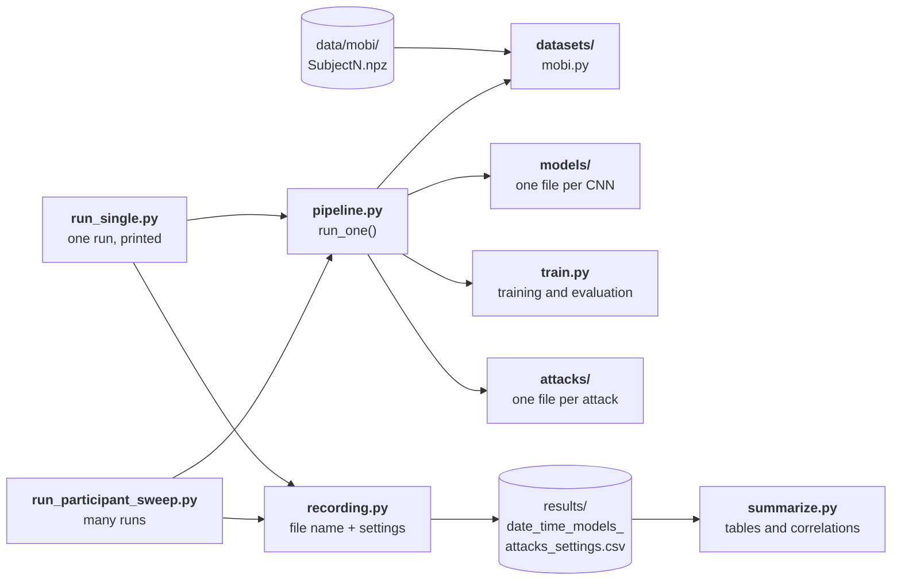
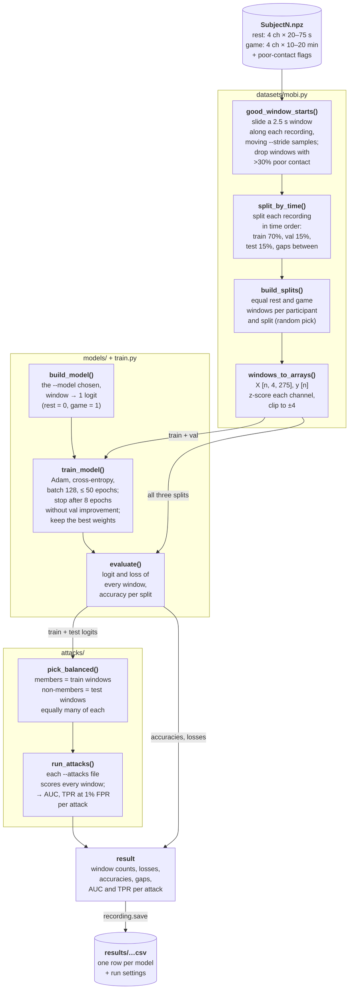
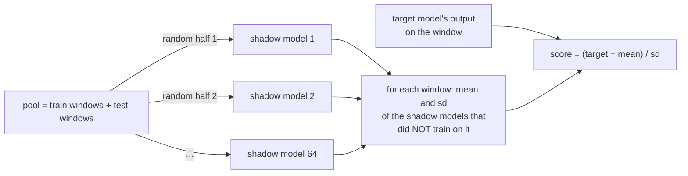
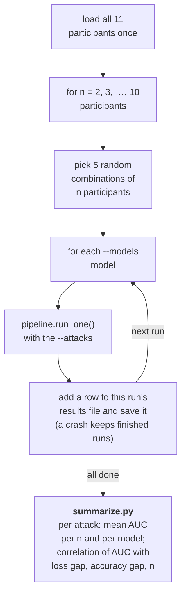

# How the code works

The diagrams use [Mermaid](https://mermaid.js.org/). GitHub draws them
automatically. In VS Code, install the "Markdown Preview Mermaid Support"
extension and open the preview (Cmd+Shift+V).

## 1. Which file calls which



The scripts pick the dataset, models and attacks by name (`--dataset`,
`--models`, `--attacks`). Each folder's `__init__.py` holds a dictionary from
name to file, so adding one means one new file plus one line. Defaults for
training are in `config.py`. Dataset settings (window, stride, participants)
are in the dataset's own file.

## 2. One run, step by step (`pipeline.run_one`)



## 3. What each split is used for

| split | trains the model | early stopping | attacks |
|---|---|---|---|
| train (70%) | yes | | **members** |
| val (15%) | | yes | not used, because early stopping already looked at it |
| test (15%) | | | **non-members** |

## 4. How one recording is split (`datasets/mobi.py: split_by_time`)

Each recording (one participant, rest or game) is split in **time order**, not
at random:

```
start of recording                                                  end
|──────────────── train (70%) ────────────────|gap|── val ──|gap|── test ──|
```

The **gap** is wide enough that no train window shares a sample with a val or
test window. Otherwise, with overlapping windows, the model would already
have seen part of every test window during training.

- `--stride 275`: windows don't overlap, so the gap is 1 window.
- `--stride 1`: each window starts 1 sample after the previous one (99.6%
  overlap), so the gap is 275 windows.

Rest recordings are much shorter than game recordings, so the **balancing
step** in `build_splits()` keeps only as many game windows as there are rest
windows. For example, Subject 1 at stride 1 has 4,897 rest and 64,433 game
train windows. The balanced train set uses 4,897 of each.

## 5. What the attacks do (`attacks/`)

A model usually fits the windows it trained on better than new ones. Every
attack turns the target model's output on a window into a **score**, where
higher means "probably a member":

```
score of each window:   low ◄──────────────────────────► high

non-members (test)      ▁▂▃▅▆▇▇▆▅▃▂▁
members (train)                ▁▂▃▅▆▇▇▇▆▅▄▃
                                         └────┬────┘
                           the attack says "member" here
```

- **AUC 0.5**: the two curves lie on top of each other, so the attacker can't
  tell members apart. There is no privacy leak.
- **AUC 1.0**: the curves don't overlap, so the attacker always knows which
  windows were in training.
- **TPR at 1% FPR**: the share of members the attacker finds while wrongly
  flagging only 1% of non-members.

| attack | score |
|---|---|
| `loss` | −loss |
| `confidence` | probability of the true class |
| `max_confidence` | probability of the top class (ignores the label) |
| `modified_entropy` | −modified entropy |
| `lira` | how far the target's output is above what shadow models that did **not** train on the window give |

All attacks are scored on the **same** windows of the **same** target model, so
their AUCs are directly comparable. With one output for two classes, `loss`,
`confidence` and `modified_entropy` rank windows identically and always give the
same AUC.

**LiRA** needs more than the target's output:



Each shadow model is trained exactly like the target (`pipeline.train_shadow`).
A window that every model finds easy gets a high mean, so a low loss alone no
longer makes it look like a member.

## 6. The participant sweep (`run_participant_sweep.py`)



The defaults give 9 values of n × 5 combinations × 3 models = **135 runs**.
Each run gets its own seed (`seed + 1000·n + combination`), so a run can be
repeated on its own.
